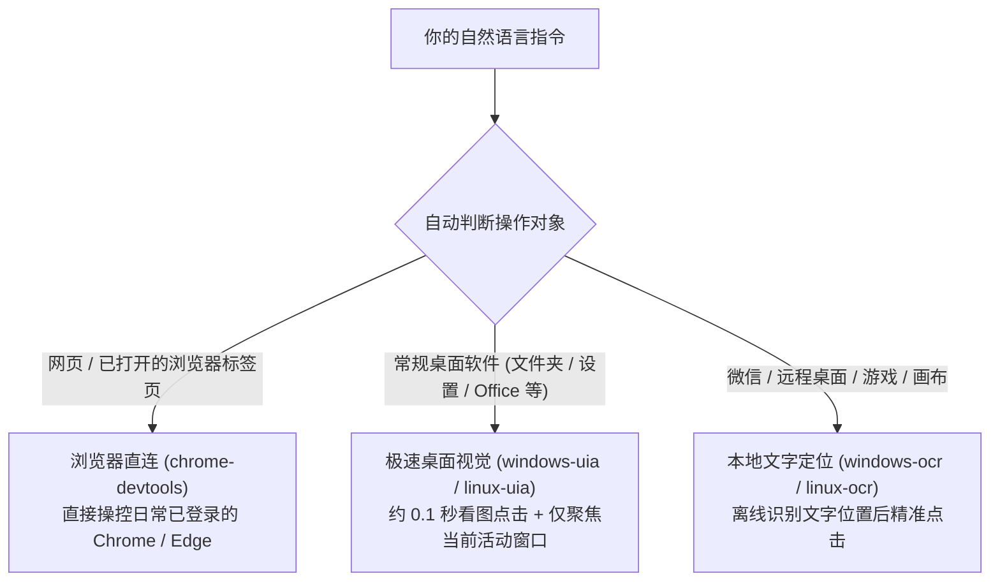

# 桌面与浏览器极速操控扩展 (`computer_use`)

让 **Google Antigravity** 在 **Windows 10/11** 与 **Ubuntu / Linux (X11)** 上像真人助手一样流畅地操作你的浏览器与桌面软件——**不用重新扫码登录网页、看屏幕快约 10 倍、微信与远程桌面也能精准点击、轻轻晃动鼠标就能随时接管控制权**。

---

## 为什么需要这个扩展？（四大直观体验升级）

默认情况下，让 AI 操作电脑或网页常常会遇到“打开空白浏览器丢掉所有登录状态”“截一次图等好几秒”“遇到微信或游戏界面点不准”“不小心碰一下鼠标就要等 30 秒才能恢复”等烦恼。本模块一步到位解决这四个核心痛点：

| 日常困扰 | 开启本扩展后的体验 |
| :--- | :--- |
| **每次都弹出空白无痕浏览器，需要重新登录** | **直连你正在使用的 Chrome / Edge 标签页**：保留 GitHub、飞书、Bilibili、云控制台等全部日常登录状态，直接读取和操作已打开的网页。 |
| **看屏幕反应慢，动辄卡顿好几秒** | **桌面视觉提速约 10 倍（约 0.1 秒响应）**：默认使用轻量极速看图模式；需要读取按钮位置时也**只看当前正在操作的窗口**，不再逐个扫描任务栏和十几个后台软件。 |
| **微信、游戏、远程桌面没有标准按钮，AI 点不准** | **本地离线 OCR 文字识别兜底**：遇到自绘界面（微信、RustDesk 远程桌面、游戏、Canvas 画布），自动在本地识别屏幕文字坐标并完成点击（全程离线运行，不上传截图，支持高分屏自动对齐）。 |
| **手碰一下鼠标，AI 就被锁定 30 秒不动** | **晃动鼠标立即接管，停手 2 秒自动恢复**：当你想随时插手操作时，只需轻轻晃动鼠标，AI 会立刻停手把控制权让给你；等你松手 2 秒后自动继续，收放自如。 |

### 它是如何协同工作的？

安装完成后，Antigravity 会根据你的任务自动挑选最合适的方式，无需手动切换：



---

## 三步快速上手（Windows & Ubuntu/Linux）

> **提示**：如果你在仓库根目录运行过一键交互安装器（Windows 运行 `.\install.ps1`，Linux 运行 `bash ./install.sh`）并选择了桌面与浏览器优化，那么**第 1 步已经自动完成**，直接跳到**第 2 步**即可！

### 第 1 步：运行一键安装脚本

脚本会自动检查你的电脑环境（如果缺少 Git、Python 3.10+ 或 Node.js，会用通俗提示告诉你需要执行哪一行命令安装），随后自动配好所有组件与规则，**不会覆盖或删除你原有的其他 MCP 插件配置**。

#### Windows 10 / 11 用户

打开 **PowerShell**，进入本仓库目录后运行：

```powershell
git clone https://github.com/hhhzingy/antigravity-toolkit.git
cd .\antigravity-toolkit\computer_use
powershell -ExecutionPolicy Bypass -File .\setup_other_device.ps1
```

#### Ubuntu / Debian Linux (X11) 用户

打开终端（Terminal），运行：

```bash
git clone https://github.com/hhhzingy/antigravity-toolkit.git
cd ./antigravity-toolkit/computer_use
bash ./setup_linux.sh
```

---

### 第 2 步：打开日常浏览器的“远程调试”开关（仅需勾选一次）

为了让 Antigravity 直接复用你平时已经登录好账号的浏览器（而不是新开一个空白浏览器），请在日常使用的浏览器中打开以下开关：

#### 如果你使用 Google Chrome：
1. 在 Chrome 地址栏粘贴并访问：
   ```text
   chrome://inspect/#remote-debugging
   ```
2. 在页面中找到 **`Enable remote debugging`**（允许远程调试 / 启用远程调试）复选框，**打勾开启**即可。

#### 如果你使用 Microsoft Edge：
1. 在 Edge 地址栏粘贴并访问：
   ```text
   edge://inspect/#remote-debugging
   ```
2. 同样找到 **`Enable remote debugging`** 复选框，**打勾开启**即可。

```text
+-------------------------------------------------------------------+
|  地址栏:  chrome://inspect/#remote-debugging                      |
+-------------------------------------------------------------------+
|  Remote debugging                                                 |
|  [x] Enable remote debugging     <-- 勾选这一项即可保留日常登录态！ |
+-------------------------------------------------------------------+
```

> **安全说明**：该开关仅在本机回环地址（`127.0.0.1`）供你电脑本地的 Antigravity 连接使用，不会向外部网络开放端口。

---

### 第 3 步：在 Antigravity 中点击 Refresh 刷新生效

1. 打开 **Antigravity** 右侧对话面板右上角的 **`...`（更多选项 / Additional Options）**；
2. 点击 **`MCP Servers`** 打开服务管理面板；
3. 点击面板右上角的 **`Refresh`** 按钮：
   - **Windows** 下会看到 `chrome-devtools`、`windows-uia-mcp`、`windows-ocr-mcp` 亮起绿灯；
   - **Linux** 下会看到 `chrome-devtools`、`linux-uia-mcp`、`linux-ocr-mcp` 亮起绿灯。

大功告成！现在你可以直接在对话里让它帮你干活了。

---

## 立即可试的日常用法示例

配置好后，你不需要记任何专业指令，直接用日常说话的方式告诉 Antigravity 即可：

- **操作已登录的浏览器网页**：
  > “帮我看一下当前 Chrome 打开的 GitHub PR 页面里有哪些报错评论，整理成清单给我。”
- **极速操控系统与桌面软件**：
  > “帮我打开系统显示设置，看看现在的屏幕分辨率和缩放比例是多少。”
- **操控无标准控件的自绘界面（微信 / 远程桌面等）**：
  > “用本地 OCR 看一下当前窗口里‘确认提交’按钮在哪里，帮我点一下。”
- **随时人工接管鼠标**：
  > 当 AI 正在移动鼠标而你想暂停它时，**直接用手晃一下鼠标**——AI 会立刻停手，等你停下鼠标满 **2 秒**后再继续。

---

## 常见问题解答 (FAQ)

### 1. 为什么 AI 操作网页时还是新开了一个空白浏览器？
请确认两点：
1. 你日常使用的 Chrome 或 Edge **当前正处于打开状态**；
2. 已经在 `chrome://inspect/#remote-debugging`（或 `edge://inspect/#remote-debugging`）中勾选了 **Enable remote debugging**。勾选后回到 Antigravity 的 `MCP Servers` 点一次 **Refresh** 即可直连。

### 2. Ubuntu / Linux 下能正常看网页，但点不动桌面窗口怎么办？
Ubuntu 默认登录界面可能运行在 Wayland 模式下（Wayland 出于隔离限制不允许外部工具模拟全局鼠标点击）。只需注销当前桌面，在登录密码框右下角点击 **齿轮图标 ⚙️**，选择 **`Ubuntu on Xorg`** 重新登录，即可获得完整的极速桌面点击、中文零丢字输入与晃动鼠标接管体验。

### 3. 觉得“晃动鼠标接管”太灵敏或不够灵敏，可以自己调吗？
可以！用记事本或任意文本编辑器打开配置文件：
- **Windows**：`%USERPROFILE%\.windows-mcp\config.toml`
- **Linux**：`~/.linux-mcp/config.toml`

修改其中的参数后保存即可：
- `idle_timeout_seconds = 2`：你停下鼠标后，AI 等待多少秒恢复操作（默认 `2` 秒）；
- `mouse_takeover_units = 500`（可选）：触发接管所需的鼠标晃动幅度（默认 `500`，调小如 `200` 则轻轻一碰就接管，调大如 `1000` 则大幅晃动才接管）。

### 4. 如何干净卸载或恢复默认设置？
本模块所有文件均独立存放在用户目录，**零修改系统核心文件**，支持一行命令无损卸载（自动保留你的其他 MCP 服务配置与其他增强模块）：
- **Windows**：`powershell -ExecutionPolicy Bypass -File .\computer_use\uninstall_computer_use.ps1`（或在根目录运行 `.\install.ps1 -Uninstall -Module 1`）
- **Linux**：`bash ./computer_use/uninstall_computer_use.sh`（或在根目录运行 `bash ./install.sh --uninstall --module 1`）

---

## 目录文件一览与开发者指南

| 文件 / 目录 | 适用平台 | 用途说明 |
| :--- | :--- | :--- |
| [`setup_other_device.ps1`](./setup_other_device.ps1) | Windows | Windows 一键环境自检、引擎拉取、补丁应用与配置写入脚本 |
| [`uninstall_computer_use.ps1`](./uninstall_computer_use.ps1) | Windows | Windows 一键无损卸载清理脚本（保留其他 MCP 服务与模块） |
| [`setup_linux.sh`](./setup_linux.sh) | Linux (X11) | Ubuntu / Debian 一键依赖检查、双引擎安装与配置写入脚本 |
| [`uninstall_computer_use.sh`](./uninstall_computer_use.sh) | Linux (X11) | Linux 一键无损卸载清理脚本（保留其他 MCP 服务与模块） |
| [`linux-gui-mcp/`](./linux-gui-mcp/) | Linux (X11) | Linux 极速桌面视觉 + 焦点窗口控件识别引擎与多浏览器智能启动器 |
| [`windows-mcp-speedup.patch`](./windows-mcp-speedup.patch) | Windows | `Windows-MCP` 纯视觉提速与单焦点窗口扫描优化补丁 |
| [`computer-control-mcp-opti.patch`](./computer-control-mcp-opti.patch) | Windows / Linux | 本地 OCR 高分屏缩放还原、单窗口坐标偏移补偿与多屏安全裁剪补丁 |
| [`configs/`](./configs/) | Windows / Linux | MCP 配置参考模板、2 秒鼠标接管保护配置与智能路由规则 |
| [`README_DEV.md`](./README_DEV.md) | Windows / Linux | **开发者与贡献者进阶手册** |

### 面向开发者与贡献者 (`README_DEV.md`)

如果你想深入了解底层源码补丁细节、调整控件树节点数量上限、修改 RapidOCR 识别置信度阈值，或者查阅 2K/4K 高分屏 DPI 坐标换算公式，欢迎阅读进阶开发文档：

👉 **[阅读《桌面 GUI 双引擎 MCP 源码导读与二次开发指南 (`README_DEV.md`)》](./README_DEV.md)**

---

## 致谢与上游开源项目说明

本模块基于以下开源项目进行集成、增量补丁优化与跨平台扩展（安装脚本会在本地按需拉取上游仓库并应用 `.patch` 补丁，各上游项目遵循其原有开源协议）：

- **[CursorTouch/Windows-MCP](https://github.com/CursorTouch/Windows-MCP)**（MIT）：Windows 原生桌面控制基础，`linux-gui-mcp` 亦对齐并借鉴了其工具协议与鼠标晃动接管设计；
- **[AB498/computer-control-mcp](https://github.com/AB498/computer-control-mcp)**（MIT）：跨平台本地 RapidOCR 与防黑屏截图基础；
- **[ChromeDevTools/chrome-devtools-mcp](https://github.com/ChromeDevTools/chrome-devtools-mcp)**（Apache-2.0）：Chrome / Edge CDP 浏览器直连控制引擎。
